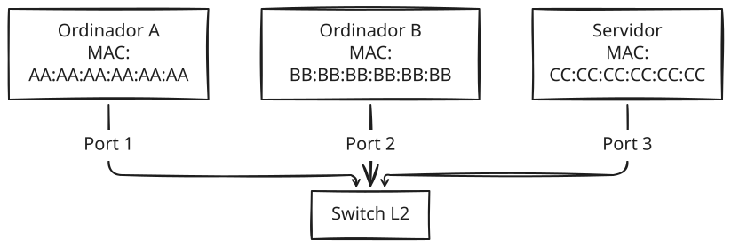
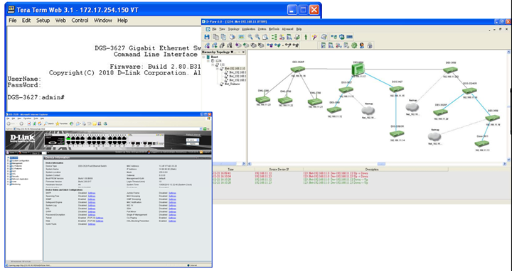

# UD8. Commutadors de xarxa local

RA4. Instal·la equips en xarxa, descrivint-ne les prestacions i aplicant tècniques de muntatge.

## Introducció

Les xarxes locals cablejades, segueixen una topologia en estrella, on tots els equips estan connectats a un dispositiu central anomenat **commutador**. Aquest dispositiu és el que permet que els equips es comuniquin entre ells i amb altres xarxes.

## Funcionament del switch

El switch s'encarrega de rebre els paquets de dades que li arriben per un port i enviar-los al port corresponent on es troba l'equip destinatari. Per fer això, el switch manté una taula d'adreces MAC que li permet saber a quin port està connectat cada dispositiu de la xarxa.

### Domini de Col·lisió vs. Domini de Difusió

- Domini de col·lisió: Segment de xarxa on dos o més dispositius poden enviar dades al mateix temps i provocar una col·lisió. Un switch aïlla els dominis de col·lisió en cada un dels seus ports. Si un switch té 24 ports, crea 24 dominis de col·lisió independents.

-Domini de difusió (Broadcast Domain): Àrea de la xarxa on qualsevol dispositiu pot enviar una trama de broadcast (destinada a FF:FF:FF:FF:FF:FF) i tots els altres dispositius la rebran. Per defecte, tots els ports d'un switch pertanyen al mateix domini de difusió.

> **Idea Clau**: Els hubs tenen 1 sol domini de col·lisió i 1 domini de difusió. Els switches tenen 1 domini de col·lisió per port (0 si és una xarxa moderna *full duplex*) i 1 domini de difusió per defecte (si no s'usen VLANs).

### La Taula d'Adreces MAC (Forward Database)

El switch pren decisions de reenviament consultant la seva **taula d'adreces MAC** (també coneguda com a *Content Addressable Memory* o *CAM Table*). Aquesta taula associa cada port del switch amb l'adreça MAC del dispositiu connectat a ell.

El funcionament de la taula MAC segueix 4 passos fonamentals:

1. **Aprenentatge (*Learning*):** Quan arriba una trama a un port, el switch examina l'**adreça MAC d'origen**. Si aquesta adreça no està a la taula, la guarda associada al port d'entrada juntament amb un temporitzador (*timer*).

2. **Inundació (*Flooding*):** El switch examina l'**adreça MAC de destí**. Si l'adreça de destí és desconeguda (no està a la taula) o és de difusió (*broadcast*), el switch reenvia la trama per **tots els ports excepte el port d'origen**. Com que abans que un equip pugui comunicar-se amb un altre, necessita saber la seva adreça MAC, envia un ARP. Amb aquest ARP, el switch aprèn l'adreça MAC de l'equip que envia la trama i la guarda a la taula.

3. **Reenviament (*Forwarding*):** Si l'adreça MAC de destí és coneguda i es troba a la taula, el switch reenvia la trama **únicament pel port corresponent**.

4. **Envelliment (*Aging*):** Les entrades de la taula s'eliminen automàticament si no hi ha activitat durant un temps determinat (normalment 300 segons per defecte en equips Cisco).

## Tipus de switch

En funció de les capacitats i prestacions, podem classificar els switches en diferents categories:

- **Switch no gestionable:** Són els més senzills i econòmics. No permeten configuració ni monitoratge. S'utilitzen en xarxes petites o domèstiques, ja que funcionen sense haver de configurar res. Només cal connectar els cables i llestos.

- **Switch smart:** Dissenyats pel mercat SMB (Small Medium Bussiness). Configuracions bàsiques via Web: VLAN, QoS, etc. Són més cars que els no gestionables, però ofereixen més control i seguretat.

- **Switch gestionable:** Permeten una configuració completa i monitoratge de la xarxa. Són els més cars i s'utilitzen en entorns professionals on es necessita un control total de la xarxa. Permeten configurar VLANs, QoS, Spanning Tree Protocol, entre altres funcions avançades. Poden ser:

    - **Switch Layer 2:** Operen en la capa de dades (Data Link Layer) del model OSI.
    - **Switch Layer 3:** A més de les funcions d'un switch Layer 2, poden realitzar encaminament de paquets basant-se en adreces IP. Són útils en xarxes grans on es necessita segmentació i encaminament entre VLANs, actuant com a switch de nucli (core).

## Green Ethernet ♻️

Els switchs ofereixen millores tècniques per reduir el consum elèctric amb per exemple:

- Adequar la potència a la llargada dels cables. Per defecte, el switch envia la màxima potència a tots els ports, però si el cable és curt, no cal tanta potència. Això permet estalviar energia.
- Detectar ports no utilitzats i posar-los en hibernació. D'aquesta manera, si un port no té cap dispositiu connectat, el switch pot hivernar-lo per estalviar energia. Si un dispositiu es connecta al port, el switch detecta la connexió i torna a activar el port.
- Passar a mode hibernació durant estones sense utilització. Per exemple, quan l'oficina està tancada, el switch pot reduir el consum d'energia posant-se en mode hibernació. Quan es detecta activitat a la xarxa, el switch torna a l'estat normal.

Des d'un punt de vista ambiental, aquestes millores són molt importants, ja que permeten reduir el consum energètic i, per tant, la petjada de carboni de l'empresa. A més, també poden suposar un estalvi econòmic significatiu en la factura d'electricitat.

## Gestió del switch

Els switchs gestionables (managed) es poden administrar des de diverses opcions:

- Consola via protocol RS-232: és la forma més directa, ja que permet connectar-se directament al switch amb un cable de consola i configurar-lo mitjançant una interfície de línia de comandes (CLI).
- Connexió remota (ssh o telnet): al switch se li assigna una adreça IP i es pot accedir a ell des d'un ordinador remot mitjançant protocols com SSH o Telnet. Això permet configurar i monitoritzar el switch sense necessitat d'estar físicament davant del dispositiu.
- Front-end Web: molts switches gestionables ofereixen una interfície web que permet configurar i monitoritzar el dispositiu des d'un navegador. Aquesta interfície és més amigable per a usuaris que no estan familiaritzats amb la línia de comandes.
- Gestor SNMP (Simple Network Management Protocol) que permet centralitzar la gestió des d’una aplicació d’ordinador. Permet usar software de gestió de xarxes per monitoritzar i administrar múltiples dispositius de xarxa des d'una sola ubicació. Això és especialment útil en entorns amb molts switches i altres dispositius de xarxa.

